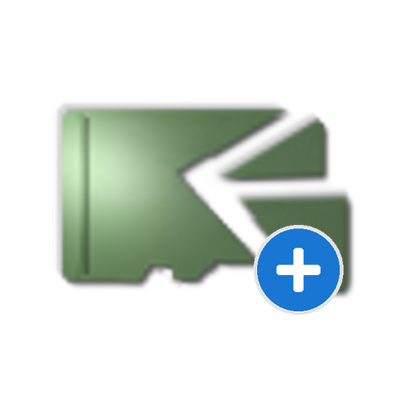

  

<h1 align="center">DiskUsage</h1>

  <a href="README.md">English</a> | <b>Русский</b>

> Современный форк классического приложения [DiskUsage](https://github.com/IvanVolosyuk/diskusage) от Ивана Волосюка (Ivan Volosyuk). Искренняя благодарность автору за создание незаменимой утилиты для Android и публикацию исходного кода!

---

## О приложении

DiskUsage — высокопроизводительный визуализатор накопителей для Android. В отличие от стандартных файловых менеджеров с плоскими списками, он строит наглядную пропорциональную карту памяти (treemap), на которой размер каждого прямоугольника точно соответствует занимаемому объёму. Приближайте нужные папки, находите «пожирателей» места и безопасно освобождайте память.

**Основные возможности:**

- Визуальная пропорциональная карта внутренней памяти, SD-карт и внешних USB-накопителей
- Плавная интерактивная навигация и масштабирование дерева папок
- Безопасное удаление с подробными свойствами и защитой от случайного стирания
- Быстрый переход к выбранным файлам и каталогам в популярных проводниках (MiXplorer, Total Commander, Solid Explorer, Material Files)

---

## Отличия от оригинала

### ✦ Добавлено

- **Светлая тема**
- **Универсальный Root** — проверенная совместимость с современными рут-решениями (KernelSU, Magisk и т.д.)
- **Сканирование без Root через Shizuku и Porter** — анализ системных разделов (`/`, `/data`, `/system`) без модификации ядра:
  - Поддержка Shizuku
  - Поддержка [Porter](https://github.com/d4rken-org/porter) (служба от автора SD Maid)
- **Центр управления «Разрешения и доступ»** — единая шторка с индикаторами (🟢 / 🟡 / ⚪) для системных разрешений и привилегий, кнопками проверки и подсказками

### ✦ Улучшено

- Полная совместимость с современными версиями Android (Android 11–15+)
- Открытие папок в сторонних проводниках без сбоев `FileProvider`
- Обновлённый интерфейс: аккуратные нижние шторки вместо устаревших всплывающих окон

---

## Лицензия

Проект наследует лицензию оригинального репозитория [DiskUsage](https://github.com/IvanVolosyuk/diskusage).
Распространяется на условиях лицензии GNU General Public License версии 2 или более поздней. Подробности см. в файле [COPYING.txt](COPYING.txt).
